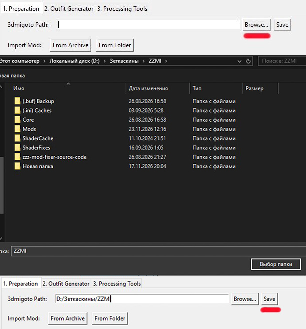
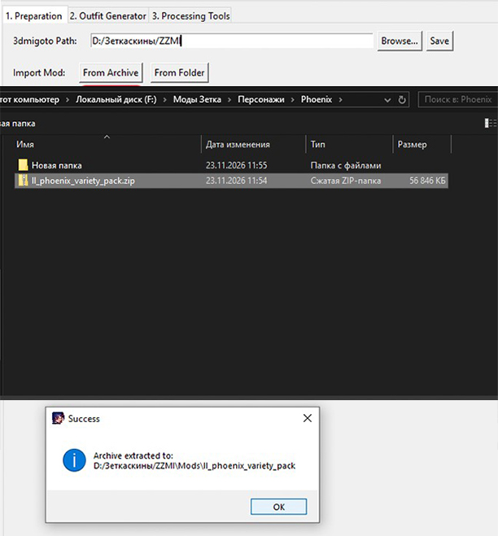
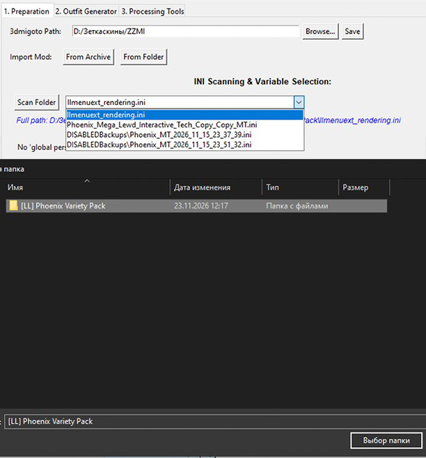
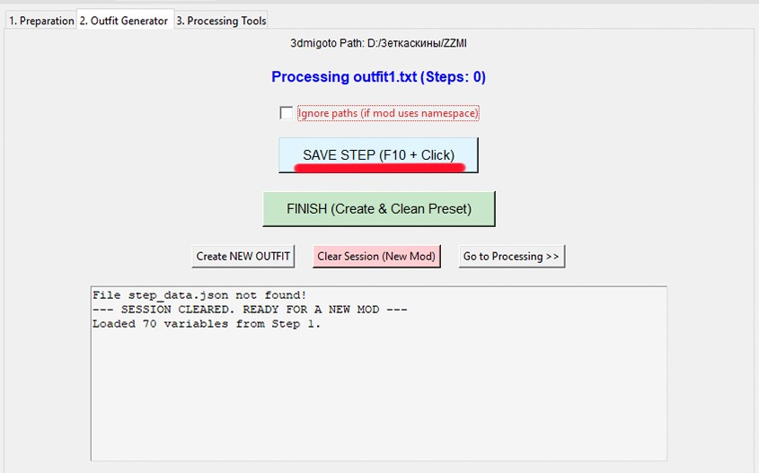
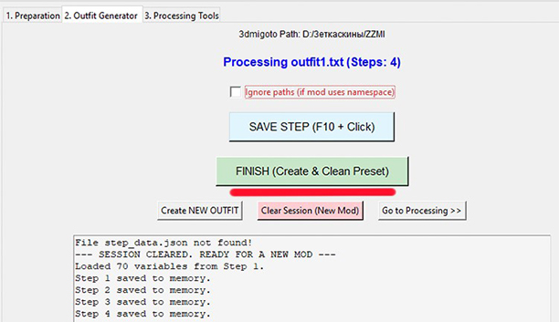
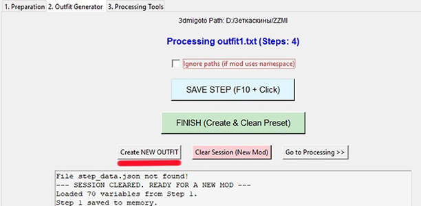
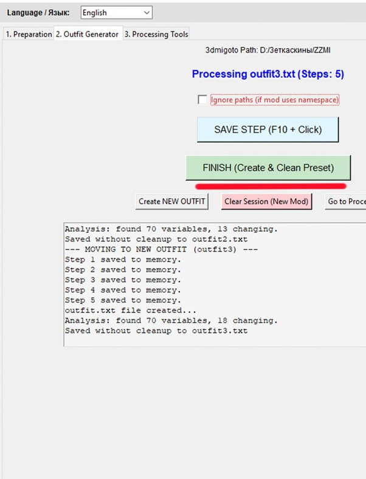
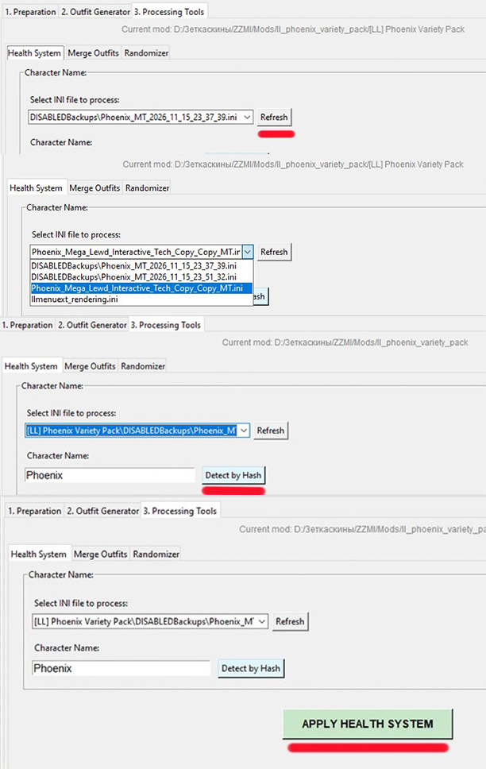
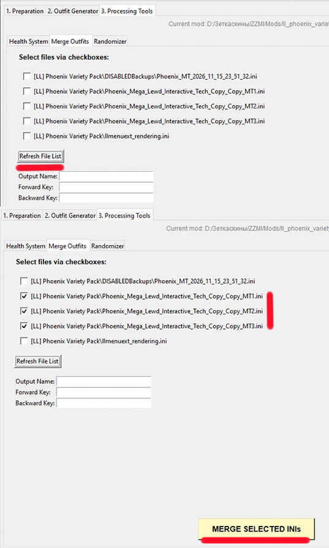
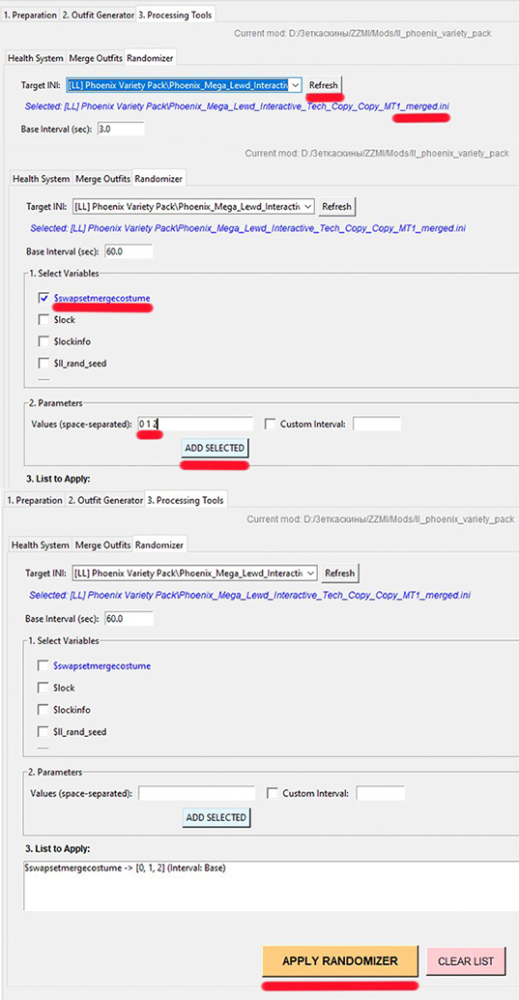

# HealthSystem — 3dmigoto Mod Processor

A tool for adding a costume destruction system based on the character's health level in **3dmigoto** mods.

[](LICENSE)
[](https://www.python.org/)
[]()

---

## 📖 Description

The program adds a health-based costume destruction system to a mod. You configure different costume states step by step for different destruction stages, and in-game the outfit changes automatically as the character's HP decreases.

You can create **multiple outfits** with their own destruction stages, **merge** them into one INI with hotkey switching, and add a **randomizer** for random changes.

---

## ✨ Features

- 📦 **Mod import** — from `.zip` / `.rar` / `.7z` archives or from a folder.
- 🎨 **Outfit generator** — creates variable presets for each destruction stage.
- ❤️ **Health system** — hardcodes outfit changes based on the character's HP.
- 🔗 **Outfit merging** — several outfits in one INI with hotkey switching.
- 🎲 **Randomizer** — random variable changes with configurable intervals.
- 🌐 **Multilanguage** — Russian, English, and custom languages via `lang_*.json`.
- 🔍 **Auto-detect character** by hash (`character_hashes.json`).
- 🧹 **Unused variable cleanup** — so they don't get "locked" by the health system.

---

## 🖼 Screenshots

### Tab 1 — Preparation






### Tab 2 — Outfit Generator






### Tab 3 — Processing Tools






> 📌 Screenshots show only the program interface, with no in-game content.

---

## 📋 Requirements

**For users:** 
[Releases](../../releases).
- Windows 10/11
- XXMI
- Ready-made build from [Releases](../../releases)

**For developers:**

- Windows 10/11
- XXMI
- Python 3.10+
- Dependencies from [`requirements.txt`](requirements.txt): `py7zr`, `pybcj`, `rarfile`
- [7-Zip](https://www.7-zip.org/) — for extracting `.rar` archives

---

## 🚀 Installation

### Option 1: ready-made `.exe` (for users)

1. Go to [Releases](../../releases).
2. Download the latest archive.
3. Extract it to any folder.
4. Run `main.exe`.

> ⚠️ Make sure the following files are next to `main.exe`:
> - `lang_ru.json`
> - `lang_en.json`
> - `character_hashes.json`
>
> The archive in Releases already includes them — just don't delete them.

### Option 2: from source (for developers)

```bash
git clone https://github.com/dipole128/ZZZHealthSystemTools.git
cd ZZZHealthSystemTools
pip install -r requirements.txt
python main.py
```
📖 Usage

Detailed guide with screenshots: docs/instruction.html — open it in a browser.
Quick overview: three steps
Tab 1 — Preparation

    Set the path to the ZZMI folder (where d3dx_user.ini is located) and click Save.

    Import the mod from an archive or a folder.

    Click Scan Folder, pick the desired .ini file, and select the variables.

    Click Save Selected Variables.

Tab 2 — Outfit Generator

    In-game, select the desired outfit and press F10.

    Click Save Step in the program.

    Switch the outfit state → F10 → Save Step.

    Repeat for all destruction stages.

    Click Finish (the outfit won't be saved without it!).

Tab 3 — Processing Tools

    Health System — select the INI, detect the character, click Apply.

    Merging — if you have multiple outfits, check them and click Merge.

    Randomizer — set up random outfit and variable switching.

    💡 Details on unused variable cleanup, working with multiple outfits, and randomizer rules — see the full guide.

🛠 Building from Source
Windows
bash

python -m PyInstaller --noconsole --onedir --icon=myicon.ico ^
    --add-data="myicon.ico;." ^
    --collect-all bcj --collect-all py7zr ^
    main.py

The build will appear in dist/main/.

Don't forget to place these files next to main.exe in dist/main/:

    lang_ru.json

    lang_en.json

    character_hashes.json

    ⚠️ If --onefile causes issues with bcj._bcj (a C extension for 7z), use --onedir. It is more stable with C extensions and easier to debug.

🌐 Localization

The program automatically detects all lang_*.json files next to main.py / main.exe.
Adding your own language

    Copy lang_en.json to lang_xx.json (e.g., lang_ja.json).

    Change "language_name" (e.g., to "日本語").

    Translate all values while keeping keys and placeholders {} and \n intact.

    Restart the program — the language will appear in the Language menu.

Languages included in the repository

    🇷🇺 Russian (lang_ru.json)

    🇬🇧 English (lang_en.json)

    Want to add a translation? Open a PR with a new lang_xx.json.

🐛 Known Issues

    Building with --onefile may cause issues with bcj._bcj. Solution: use --onedir.

    Extracting .rar requires 7-Zip to be installed.

If you find a bug — open an Issue with a description and a screenshot of the program log (shown on Tab 3).
🤝 Contributing

Pull requests are welcome. Please:

    Fork the repository.

    Create a branch: git checkout -b feature/my-feature.

    Make your changes and test them.

    Submit a PR with a description.

📄 License

This project is distributed under the MIT License. See LICENSE.

The license covers only the source code of this project and does not apply to:

    game assets, models, textures;

    third-party mods;

    any content owned by HoYoverse.

🙏 Credits & Disclaimer

This is an unofficial community-made tool.
It is not affiliated with HoYoverse, the game developers, or mod authors.

The project does not contain or distribute game assets, models, textures, or third-party mods.
All rights to the game and its content belong to HoYoverse.
Rights to mentioned mods belong to their respective authors.

Variable names and code examples are provided solely to demonstrate how the tool works.
💬 Feedback

    🐛 Report a bug

    💡 Suggest an idea

<p align="center"> <i>Made with ❤️ for the 3dmigoto community</i> </p>	
